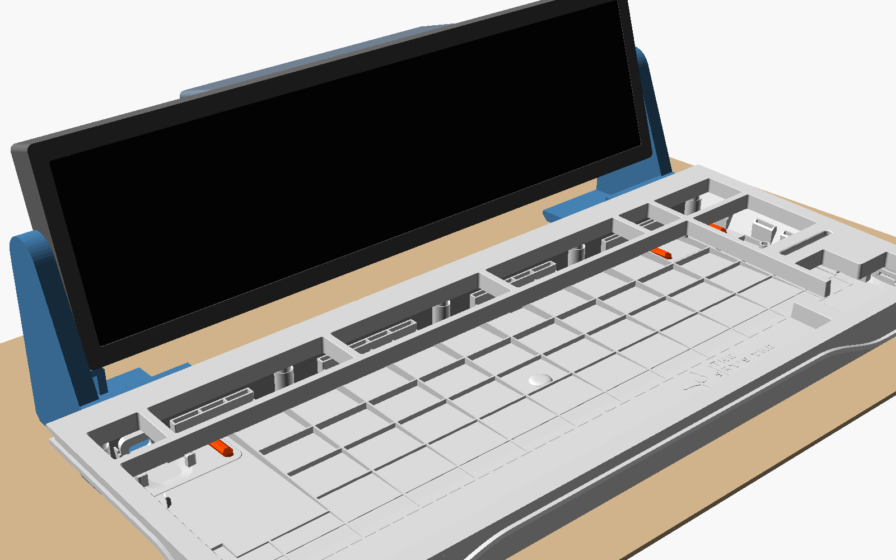
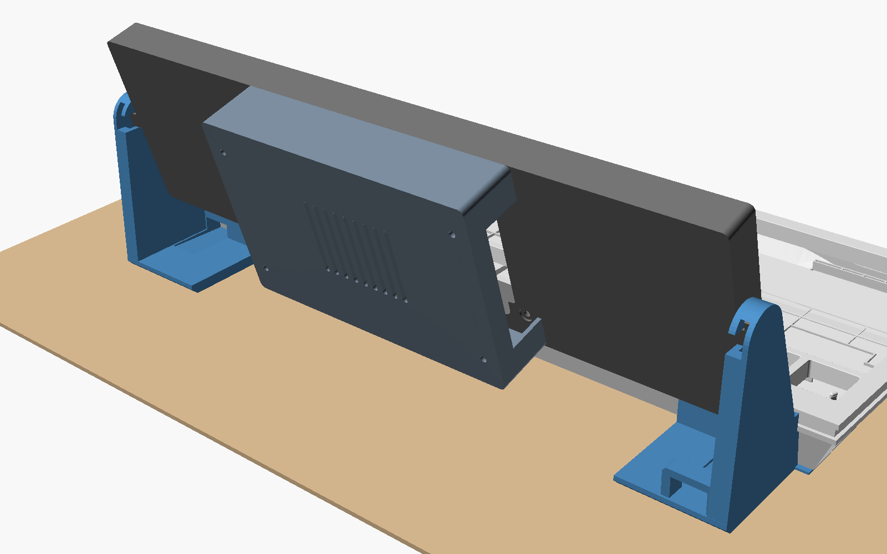
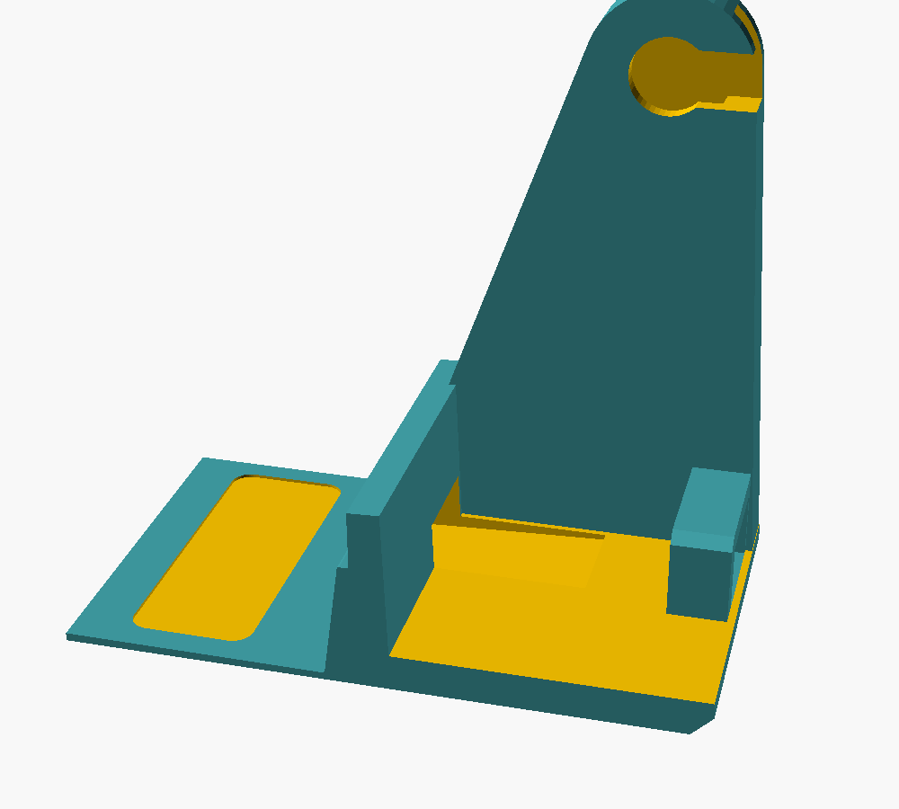
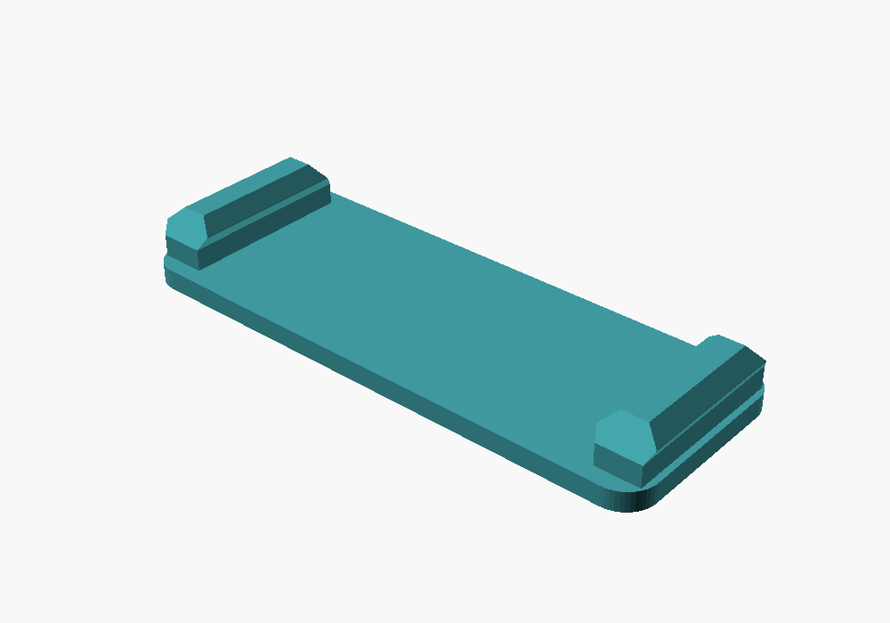
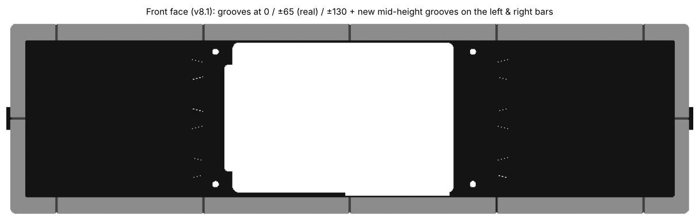
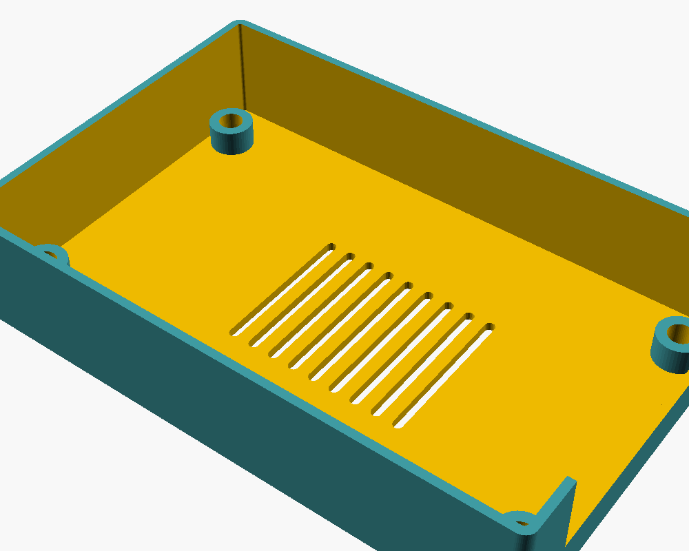

# Wooting 80HE + Waveshare 11.9" HDMI LCD mount

A 3D-printable mount that puts a [Waveshare 11.9" HDMI LCD](https://www.waveshare.com/11.9inch-HDMI-LCD.htm) (320×1480) behind a **Wooting 80HE**, with a Raspberry Pi 4 on the back of the display. The stands clip into the keyboard's foot slots instead of the silicone feet, so you don't need tools, screws or glue on the keyboard.

- **Stands:** PETG, with a glued-in TPU clip pad that snaps into the 80HE foot slots. Each stand hugs the keyboard's rear edge with no gap, and the rear bottom edge is bevelled so it slides onto a mouse pad.
- **Tool-free pivot:** the case ends in flatted axles with 16-sided heads that run in hidden rails inside the stands. You slide the screen in from behind while it lies flat, then swing it up. Tilt clicks in 22.5° steps, and the screen can't fall out at any normal angle.
- **Slim case:** printed in 3 pieces and glued with hidden dovetails. The glass sits flush in a rebate on a 0.5 mm ledge and is clamped by the display's own 25 mm brass standoffs. V-grooves every 65 mm (real seams plus decorative ones) make the joints read as a design line.
- **Back cover:** presses onto the brass standoffs over the Pi 4 and its HDMI/USB-C adapters. It has a USB/Ethernet opening and vents.
- **Left stand:** a tunnel for the keyboard's USB-C plug and a solid cable arch.

| | |
|---|---|
|  |  |
|  |  |

## Print (Bambu Lab P2S, 256 × 256 bed)

| File | Material | Qty | Notes |
|---|---|---|---|
| `stl/pad.stl` | **TPU 95A** | 2 | Flat glue face down. 100 % infill, slow (~30 mm/s). Both pads are identical and symmetric, so either way round fits |
| `stl/stand_left.stl`, `stl/stand_right.stl` | PETG | 1 each | As exported (desk face down), no supports. 4 walls, 30 % infill |
| `stl/case_mid.stl` | PETG | 1 | Back plate down, no supports |
| `stl/case_end_left.stl`, `stl/case_end_right.stl` | PETG | 1 each | Back plate down, no supports |
| `stl/cover.stl` | PETG | 1 | Back face down, open side up, no supports |
| `stl/case_full.stl` | PETG | – | One-piece case, only for beds ≥ 313 mm |

## Hardware

- The display's four 25 mm brass standoffs (male–female, 4.8 mm across flats). They screw through the case's back plate into the display and clamp it.
- No screws needed for the cover; it presses onto the standoffs. Optionally add 4× M2.5×6 through the cover holes.
- Medium CA glue or 2-part epoxy for the case joints.
- For TPU → PETG: flexible contact adhesive or gel CA. Scuff both faces with 240 grit.

## Assembly

1. **Pads:** glue each TPU pad into the shallow recess on the underside of a stand, then clamp or weigh it down until the glue cures.
2. **Case:** lay the mid piece **front edge down** and lower each end piece onto it from above, gluing as you go. The back-plate dovetails, the hidden wall dovetails and the four splints all slide together in that direction. The glue line sits at the bottom of a V-groove.
3. **Display:** remove the 4 brass standoffs. Drop the display into the tray from the front, with the HDMI/USB-C edge toward the bottom (the connector cavity). Screw the standoffs back in from behind; their hex sits in a round recess, so it can stop at any angle. Mount the Pi, plug in the HDMI adapter and the angled USB-C, then press the cover onto the standoffs.
4. **Stands:** pull out the 80HE's silicone feet and press each stand's pad into a foot pocket until the clips click. The left stand (with the tunnel and arch) goes on the USB-cable side. Thread the keyboard end of the USB-C cable through the arch, then through the tunnel, and plug it in.
5. **Screen:** lay it flat, face up, behind the keyboard at the height of the stands' rails. Slide both axle heads forward into the rails until they click, then swing the screen up.

To tilt, push the screen; it clicks in 22.5° steps. To remove it, tilt it back until it's flat and pull it backwards out of the rails.

## Customising

Everything is parametric in [`wooting80he_display_mount.scad`](wooting80he_display_mount.scad) (OpenSCAD 2021.01+). Set `part`, render (F6) and export STL. Printable parts come out already oriented for printing. Useful parameters:

| Parameter | Default | What it does |
|---|---|---|
| `screen_bottom` | `[84, 15]` | Screen position (Y = 9.6 mm behind the keyboard). If you move it, shift `base_back` by the same amount |
| `base_back` | `120.5` | Where the stands end (just behind the axle) |
| `recline` | `15` | Design recline of the screen (deg) |
| `pivot_fit` | `-0.05` | Click strength (−0.15 stiffer, +0.05 softer) |
| `head_n` | `16` | Head sides: 16 = 22.5° steps, 12 = 30°, 24 = 15° |
| `clip_barb` | `4.3` | Clip width over the barbs (press-in force) |
| `clip_release` | `0.85` | Barb back face (removal force): 1.0 easier, 0.6 harder |
| `pad_fit` | `0.25` | Pad ↔ glue recess clearance per side |
| `kb_lift` | `1.0` | Stand thickness under the keyboard (keyboard tilt ≈ 2.6°) |
| `sled_h`, `sled_round` | `3`, `false` | Rear ramp height; 45° bevel or round (round needs supports) |
| `cover_grip` | `0.15` | Cover press fit on the standoffs |
| `fit_tol`, `ledge` | `0.15`, `0.5` | Glass clearance, glass ledge |
| `usb_notch` | | Opening for the angled USB adapter board |
| `fake_seams`, `side_grooves` | `true` | Decorative grooves |
| `top_rim` | `= chin` | Top border height (symmetric case) |
| `guide_h`, `guide_wall` | `9`, `3.5` | Cable arch size |

`kb_rear_profile.scad` (the keyboard's rear-edge profile, used by the stands) has to stay next to the .scad.

### Assembly preview (optional)

`part = "assembly"` renders the stands, pads, case, cover and a rough Pi outline without any extra files. To also show the keyboard and display, export them from the official STEP files to STL, put them next to the .scad, and set `show_keyboard` / `show_display = true`:

- `wooting80he_case_preview.stl`: from the 80HE case in [WootingKb/wooting-design](https://github.com/WootingKb/wooting-design), in the "K frame" described at the top of the .scad
- `waveshare_11.9_hdmi_lcd.stl`: from the 3D model on the [Waveshare wiki](https://www.waveshare.com/wiki/11.9inch_HDMI_LCD)

These files are not included in this repository.

## Sources

- Wooting 80HE design files: https://github.com/WootingKb/wooting-design (CERN-OHL-S)
- Waveshare 11.9inch HDMI LCD: https://www.waveshare.com/11.9inch-HDMI-LCD.htm, wiki and 3D model: https://www.waveshare.com/wiki/11.9inch_HDMI_LCD
- The glass rebate and ledge dimensions were cross-checked against the [Waveshare 11.9" case on Thingiverse](https://www.thingiverse.com/thing:5604587) (nothing from it is included).

## License

The keyboard-facing geometry is derived from Wooting's design files, which are licensed under CERN-OHL-S v2, so this project is shared under the same licence: [CERN Open Hardware Licence Version 2 – Strongly Reciprocal](LICENSE).
